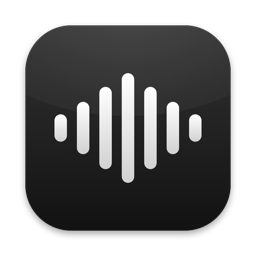
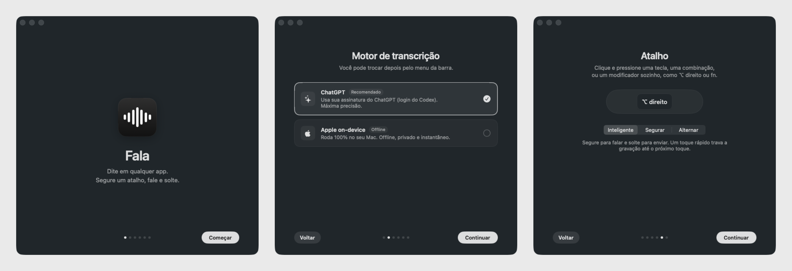

<p align="center">
  
</p>

<h1 align="center">Fala</h1>

<p align="center">
  Native macOS dictation that uses your <b>ChatGPT subscription</b>, or Apple's <b>on-device</b> speech model.<br>
  Hold a shortcut, speak, release. The text lands in whatever app you're using.
</p>

<p align="center">
  
  
  
  
</p>

> 🇧🇷 **Resumo em português:** o Fala é um app de ditado para macOS, no estilo do Wispr Flow e do superwhisper. Ele transcreve usando a sua assinatura do ChatGPT (pelo login do Codex, sem chave de API) ou o modelo de fala on-device da Apple. Para usar: segure um atalho, fale e solte, e o texto é colado no app em foco. A interface está em português. Instalação: `./scripts/build.sh --install`.

---

<p align="center">
  
</p>

<p align="center">
  
</p>

## Why

Apps like Wispr Flow and superwhisper are great, but they need another subscription or an API key. If you already pay for ChatGPT, Fala transcribes through the same endpoint that ChatGPT/Codex dictation uses, so usage counts against your existing plan. If you want something fully offline, switch to Apple's on-device model.

## Features

- **Two engines**
  - **ChatGPT**: reuses your Codex CLI login (`~/.codex/auth.json`), so there's no API key to manage. Very accurate and multilingual.
  - **Apple on-device**: `SpeechAnalyzer` / `SpeechTranscriber` from macOS 26. Offline and private, it shows the text live while you speak, and a sentence usually finishes in about 0.3 s.
- **Any shortcut**: a single key (`F5`), a combination (`⌃⌥Space`), or a lone modifier with side detection (`Right ⌥`, `Right ⌘`, `fn`). You can change it at any time.
- **Three trigger modes**
  - **Smart** (default): hold to talk, or tap once to lock recording.
  - **Hold**
  - **Toggle**

  `esc` cancels in any mode.
- **Notch island**: a black island grows out of the notch, with a waveform that follows your voice. On displays without a notch it becomes a floating Liquid Glass pill.
- **Pastes and restores your clipboard**: the text goes to the focused app, and the previous clipboard contents come back.
- **Recent transcriptions** in the menu bar, one click to copy.
- **Onboarding** that handles login, permissions and shortcut setup.
- **Tiny**: about 1.5 MB binary, no dependencies, pure Swift/SwiftUI/AppKit.

## Requirements

| | |
| --- | --- |
| OS | macOS 26 (Tahoe) or later |
| Hardware | Apple Silicon |
| To build | Xcode 26 (Swift 6.2 toolchain) |
| ChatGPT engine | A ChatGPT plan and the [Codex CLI](https://github.com/openai/codex) logged in with ChatGPT |
| Apple engine | Nothing extra; macOS downloads the language model once |

## Install

There are no prebuilt binaries. Build from source (about 10 seconds):

```sh
git clone https://github.com/pgfultz/chatgpt-speech-to-text.git
cd chatgpt-speech-to-text
./scripts/build.sh --install     # builds, copies to /Applications and launches
```

On first launch, onboarding walks you through these steps:

1. **Engine**: ChatGPT or Apple on-device.
2. **Account**: if you're not logged in, it runs `codex login`, which opens your browser. If the Codex CLI isn't installed, run `npm i -g @openai/codex` or `brew install codex` first.
3. **Permissions**:
   - **Microphone**: used only while the shortcut is active.
   - **Accessibility**: needed to detect the global shortcut and paste the text.
4. **Shortcut and mode.**
5. **Try it**: a test field to dictate into.

Fala runs from the menu bar and has no Dock icon. You can reopen Settings or onboarding from the menu bar icon.

### About code signing

`build.sh` signs the app with a **local, self-signed certificate**. `scripts/setup-signing.sh` creates it once, in a dedicated keychain at `~/.fala-signing`, and adds that keychain to your keychain search list.

This matters because macOS ties privacy permissions to the app's signature. With ad-hoc signing, every rebuild looks like a new app, and Accessibility stops working even though the toggle still shows as on. To sign with your own identity instead, set `FALA_SIGN_IDENTITY`:

```sh
FALA_SIGN_IDENTITY="Developer ID Application: Your Name (TEAMID)" ./scripts/build.sh --install
```

## Usage

| Action | What happens |
| --- | --- |
| Hold the shortcut and speak | Recording starts; the island shows a timer and a live waveform |
| Release | Audio is transcribed and pasted into the focused app |
| Quick tap (Smart mode) | Recording locks (🔒); tap again to finish |
| `esc` | Cancels recording or transcription |
| Menu bar → Recentes | Copies a previous transcription |
| Menu bar → engine | Switches between ChatGPT and Apple |

**Using `fn` as the shortcut:** set **System Settings › Keyboard › "Press 🌐 key to" → Do Nothing**. Otherwise macOS opens the emoji picker.

## How it works

```
 shortcut (CGEventTap) ──► AVAudioEngine ──┬─► level meter ──► notch island / glass pill
                                           │
                                           ├─► 16 kHz WAV ──► chatgpt.com/backend-api/transcribe ─┐
                                           │                                                       ├─► paste ⌘V
                                           └─► SpeechAnalyzer (on-device, streaming) ──────────────┘
```

**ChatGPT engine.** The Codex CLI stores a ChatGPT OAuth session in `~/.codex/auth.json`. Fala reads the access token and account id, then uploads the recording as `multipart/form-data` to `https://chatgpt.com/backend-api/transcribe`, the same endpoint that ChatGPT/Codex dictation uses. The response is `{"text": "..."}`. If the token has expired, Fala refreshes it through `auth.openai.com` and **writes the new tokens back** to `auth.json`, so Codex keeps working on the same session. The language is auto-detected unless you pick one.

**Apple engine.** Microphone buffers stream into a `SpeechAnalyzer` running `SpeechTranscriber`, the macOS 26 model. Fala falls back to `DictationTranscriber` on machines where that model isn't available. Partial results appear in the island while you speak.

### Project layout

| File | Role |
| --- | --- |
| `Sources/Fala/Hotkey.swift` | Global shortcut through `CGEventTap`: keys, combos and lone modifiers (left/right aware) |
| `Sources/Fala/Audio.swift` | `AVAudioEngine` capture, RMS level, 16 kHz mono WAV |
| `Sources/Fala/ChatGPT.swift` | Codex auth: read, refresh, write back; transcription request |
| `Sources/Fala/AppleSpeech.swift` | Streaming `SpeechAnalyzer` pipeline and model download |
| `Sources/Fala/Controller.swift` | State machine: idle → listening → transcribing → done/error |
| `Sources/Fala/Overlay.swift` | Notch island, glass pill, waveform |
| `Sources/Fala/Onboarding.swift`, `SettingsView.swift`, `Components.swift` | UI |
| `Sources/Fala/System.swift` | Paste and clipboard restore, permissions, `codex login`, launch at login |
| `scripts/build.sh` | Builds the `.app` bundle, signs it, optionally installs it |
| `scripts/make-icon.swift` | Renders the app icon in code |

## Command line helpers

These are useful for testing and debugging:

```sh
APP=/Applications/Fala.app/Contents/MacOS/Fala
say -o /tmp/t.wav --data-format=LEI16@16000 "Hello, this is a test"

$APP --transcribe /tmp/t.wav en           # transcribe a file with the ChatGPT engine
$APP --transcribe /tmp/t.wav --apple en   # transcribe a file with the Apple engine
$APP --demo --partial                     # play the island animation without the microphone
$APP --onboarding                         # reopen onboarding
```

## Troubleshooting

**Accessibility shows as enabled but Fala says it's missing.**
The permission belongs to an older build that had a different signature. Click **Redefinir** next to "Abrir Ajustes" in Fala, or run `tccutil reset Accessibility dev.fala.app`. Then grant the permission again. After that, use `build.sh`'s stable signing so it doesn't happen again.

**"Faça login no ChatGPT" (log in to ChatGPT).**
Run `codex login` and pick *Sign in with ChatGPT*. A Codex setup that uses an API key won't work for this engine.

**"Limite de uso atingido" (usage limit reached).**
Your plan's dictation quota ran out. Switch to the Apple engine from the menu bar.

**The ChatGPT engine suddenly fails with an HTTP error.**
The endpoint isn't a public API and can change without notice. Run `$APP --transcribe file.wav` to see the full error, and please open an issue.

**Nothing is pasted, but the text is on the clipboard.**
Fala needs the Accessibility permission to send ⌘V.

## Disclaimer

Fala is an independent project and is **not affiliated with, endorsed by, or supported by OpenAI or Apple**. The ChatGPT engine relies on an **undocumented** endpoint and on the credentials the Codex CLI stores on your machine. It may stop working at any time, and you are responsible for using it in line with OpenAI's terms. Fala sends audio only to the endpoint of the engine you select, and stores nothing except settings and your last 30 transcriptions (kept locally in `UserDefaults`).

## Contributing

Issues and pull requests are welcome. Some ideas:

- [ ] English UI (strings are currently Portuguese only)
- [ ] Signed and notarized release builds on GitHub Releases
- [ ] Optional LLM post-processing (clean up filler words, formatting, custom vocabulary)
- [ ] Per-app engine or language preferences
- [ ] Intel support

Keep it light: no dependencies unless they really earn their place.

## License

[MIT](LICENSE)
